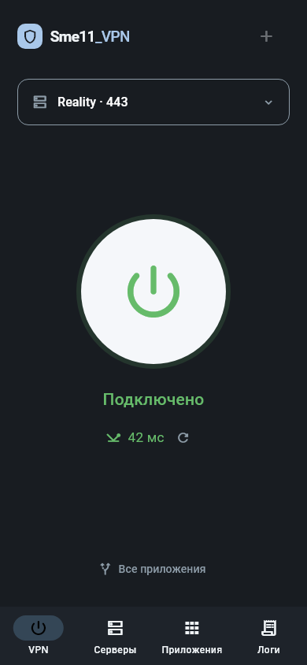
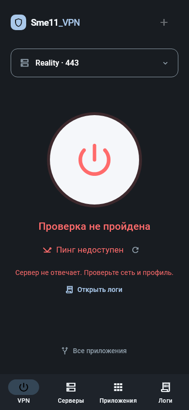

# Sme11_VPN

Минимальный VPN-клиент на Flutter для Android и Windows. Поддерживает **VLESS + Reality поверх TCP**, ручное добавление сервера и импорт одной `vless://` конфигурации из буфера обмена.

## Возможности

Версия 0.3.1: [удаление серверов и исправление автовыбора](docs/RELEASE_0.3.1.md).

- Удаление профиля кнопкой «Удалить» с подтверждением. Если VPN работает, приложение сначала отключит его. Последний сервер оставляет пустой каталог.

- Минимальный тёмный интерфейс: выбор сервера, круглая кнопка, статус и пинг.
- Зелёный статус с задержкой после успешной HTTPS-пробы; красный с текстом ошибки при неудаче. Запуск TUN сам по себе не подтверждает доступность сервера.
- Android: выбор установленных приложений через системный VPN allowlist.
- Windows: выбор EXE и маршрутизация по полному пути процесса; остальные соединения — напрямую.
- Режим «Все приложения» при необходимости.
- Логи: успешные операции, события, предупреждения, ошибки и диагностика. Поиск, сортировка, экспорт TXT и копирование с учётом фильтров.
- Профиль хранится в защищённом хранилище; UUID и ключи маскируются в журнале.
- QR-коды, подписки и WireGuard не используются.
- До 20 отдельных профилей inbound, ручное переключение и HTTPS-проверка доступности с задержкой и временем результата.
- Необязательный автовыбор по задержке: URLTest раз в минуту, допуск 100 мс; по умолчанию выключен.
- Android: постоянное уведомление с активным сервером, загрузкой и отдачей в кбит/с или Мбит/с, кнопкой отключения.

## Начало работы

Откройте «Добавить сервер», вставьте конфигурацию из буфера либо введите адрес, порт, UUID, SNI, публичный ключ Reality, Short ID и fingerprint. Настройка Vision должна совпадать с сервером. На вкладке «Приложения» выберите нужные программы и нажмите круглую кнопку питания на главной. Android запросит разрешение на VPN.

Пустой выбор приложений блокирует подключение. Для изменения маршрутизации или профиля сначала отключите VPN.

На вкладке «Серверы» добавьте каждый inbound отдельным профилем. «Проверить серверы» выполняет HTTPS-пробу через каждый VLESS/Reality-профиль к `https://www.gstatic.com/generate_204`; расходуется небольшой объём трафика. При отключённом VPN проверка запускает временный proxy-сервис без TUN. Результат — доступность в момент проверки, а не замер пропускной способности. Через 90 секунд результат помечается устаревшим.

Выбор сервера доступен при работающем туннеле: открытые соединения могут прерваться. В режиме «Автовыбор по задержке» ядро выбирает доступный профиль среди добавленных. Это не гарантирует максимальную скорость или мгновенное переключение. Несколько inbound одного сервера не защищают от отказа всего сервера. При недоступности всех профилей VPN-трафик не переводится напрямую; остановка самого VPN по-прежнему не является kill switch.

На Android 13+ при запуске запрашивается разрешение уведомлений; отказ не блокирует VPN. Разрешение можно изменить кнопкой «Уведомление VPN и скорость». Скорость отображается из реальных счётчиков ядра, в том числе при свёрнутом интерфейсе. Нулевой трафик — нормальное состояние.

## Разработка

Проверено с Flutter 3.47.5 / Dart 3.13.4. В этой среде Flutter расположен в `C:\flutter\bin`; добавление в PATH необязательно, можно использовать полный путь.

```powershell
.\scripts\build_android.ps1
# Или указать полный путь:
.\scripts\build_android.ps1 -Flutter C:\flutter\bin\flutter.bat
```

Скрипт включает настройку Android-плагинов, анализ и автоматические тесты. Windows-платформа отключается только в процессе сборки Android, чтобы отсутствие symlink не прерывало генерацию регистратора.

Для Windows нужны Visual Studio с нагрузкой «Разработка классических приложений на C++» и поддержка символических ссылок для Flutter-плагинов. Эти системные настройки приложение самостоятельно не меняет.

```powershell
.\scripts\prepare_windows.ps1
flutter pub get
flutter build windows --release --no-pub
```

Скрипт получает закреплённый официальный sing-box 1.13.9 и проверяет SHA-256 по GitHub Release. CMake включает ядро и DLL в папку сборки. Передавать нужно **всю папку Release**, а не один EXE. Для Windows TUN запуск выполняется пользователем от имени администратора.

## Состояние и ограничения

Обновление 0.2.1: исправлены ложная остановка при потере CommandClient, повторные подписки и гонка смены сети. Служебные события Android сохраняются отдельно от сетевого шума. APK для POCO: `dist/Sme11_VPN-0.2.1-arm64-v8a.apk`; описание изменений и проверки — [RELEASE_0.2.1.md](docs/RELEASE_0.2.1.md).

Версия 0.2.1 предназначена для личного тестирования. Статус «VPN включён» подтверждает запуск туннеля; доступность проверяется отдельно. Автовыбор меняет outbound внутри работающего ядра, но не перезапускает уничтоженный Android сервис. Kill switch отсутствует: после остановки VPN выбранные приложения могут использовать обычную сеть.

Windows: DNS в режиме выбора приложений остаётся системным; вспомогательные EXE нужно выбирать отдельно. Статистика скорости Windows пока не реализована и показывается как «—». WebSocket, gRPC, XHTTP и другие варианты транспорта отклоняются, а не преобразуются молча.

Android использует локальную модификацию `flutter_singbox_client 1.1.0` в `vendor/` с включённым автором ядром 1.14.0-alpha.20. Изменения SDK описаны в `vendor/flutter_singbox_client/PATCHES.md`. Перед публичным выпуском нужны физические устройства и оценка стабильного ядра. Windows x64 сборка готова: установщик и переносимый ZIP находятся в dist; подробности — docs/WINDOWS_RELEASE_0.2.1.md.

## Документация и лицензия

Версия 0.3.0: [описание интерфейса и проверок](docs/RELEASE_0.3.0.md). Исходники: [dmiittry/smell_vpn](https://github.com/dmiittry/smell_vpn).

### Интерфейс

Контрольные изображения из widget-тестов с синтетическим профилем и тестовой задержкой 42 мс; это демонстрация состояний, не замер реального сервера.

 

Пинг на экране — время HTTPS-запроса через VLESS/Reality к gstatic.com, а не ICMP и не скорость скачивания. Проверка выполняется после подключения и смены активного сервера, раз в минуту при открытом приложении и вручную кнопкой обновления. Неудачная проба не отключает работающий VPN; подробности доступны в логах. Недоступность проверочного сайта сама по себе не доказывает поломку сервера.

### Сборка из Git

```powershell
git clone https://github.com/dmiittry/smell_vpn.git
cd smell_vpn
.\scripts\build_android.ps1 -Flutter C:\flutter\bin\flutter.bat
# Для Windows сначала подготовьте ядро:
.\scripts\prepare_windows.ps1
.\scripts\build_windows.ps1 -Flutter C:\flutter\bin\flutter.bat
```

Требования и подпись сборок описаны в [DEPLOY.md](docs/DEPLOY.md). В Git включён оригинальный Android libbox.aar (около 91 МиБ) с закреплённой SHA-256; инструменты разработки, временные сборки, настройки компьютера и пользовательские профили не публикуются.

[Все документы](docs/README.md), [архитектура](docs/ARCHITECTURE.md), [сборка](docs/DEPLOY.md), [проверки](docs/TESTING.md), [решения](docs/DECISIONS.md).

Проект использует GPLv3-компоненты. Условия: [LICENSE](LICENSE), [зависимости и атрибуция](docs/DEPENDENCIES.md). При распространении необходимо предоставить соответствующие исходники и сохранить лицензионные уведомления. Код и графические ресурсы Hiddify не копировались.
